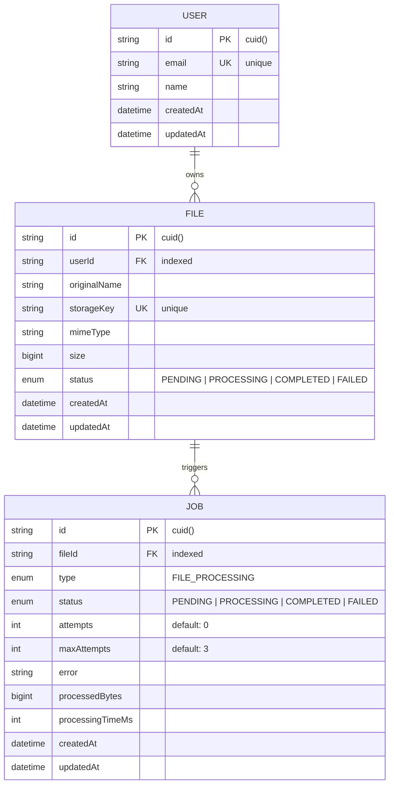

# StreamForge — High-Performance File Processing & Distributed Job System

[](https://nodejs.org/)
[](https://www.typescriptlang.org/)
[](https://fastify.dev/)
[](https://www.postgresql.org/)
[](https://www.prisma.io/)
[](https://redis.io/)
[](https://bullmq.io/)
[](https://www.docker.com/)

> A scalable, event-driven backend system engineered to decouple heavy file ingestion and stream processing from API request-response lifecycles using distributed job queues, database-level concurrency controls, and fault-tolerant worker pools.

---

## 📑 Table of Contents

- [Executive Summary](#-executive-summary)
- [System Architecture](#-system-architecture)
- [Core Engineering Highlights](#-core-engineering-highlights)
- [Technology Stack & Architectural Rationale](#-technology-stack--architectural-rationale)
- [Database Schema & Integrity](#-database-schema--integrity)
- [API Reference](#-api-reference)
- [Queue & Worker Lifecycle](#-queue--worker-lifecycle)
- [Project Structure](#-project-structure)
- [Getting Started](#-getting-started)
- [End-to-End Verification Walkthrough](#-end-to-end-verification-walkthrough)
- [Production Roadmap](#-production-roadmap)
- [Author & Connect](#-author--connect)

---

## 🎯 Executive Summary

In traditional web applications, handling large file uploads and synchronous processing directly inside the HTTP request loop leads to blocked event loops, connection timeouts, high latency, and poor user experience.

**StreamForge** solves this problem by decoupling file ingestion from heavy background processing:
1. **Low-Latency Ingestion**: The Fastify API accepts multipart streams, validates MIME type and payload boundaries, stores the binary asset, registers the metadata within an ACID transaction, and immediately returns a `201 Created` response.
2. **Distributed Queue Offloading**: A background job is enqueued to **BullMQ** (powered by **Redis**), isolating compute overhead from the API server.
3. **Autonomous Worker Execution**: Independent worker processes consume jobs, process files asynchronously, track processing metrics (bytes processed, execution time), and persist state transitions atomically in **PostgreSQL**.
4. **Resilience & Observability**: Features automatic exponential backoff retries, state machine validation, safe cancellation, queue pause/resume controls, and graceful shutdown handling.

---

## 🏗️ System Architecture

### Architectural Data Flow

```mermaid
flowchart TD
    Client([Client / Frontend])
    
    subgraph API_Layer ["API Layer (Fastify + TypeScript)"]
        UploadEndpoint["POST /api/v1/files/upload"]
        JobControls["Queue & Job Management Endpoints"]
        Validator["Zod Validation & AppError Handler"]
    end

    subgraph Storage_Layer ["Storage Layer"]
        LocalStorage["Local / Object Storage Provider\n(users/:id/files/:uuid)"]
    end

    subgraph Database_Layer ["Database Layer (PostgreSQL + Prisma)"]
        UserTable[(User Model)]
        FileTable[(File Model)]
        JobTable[(Job Model)]
        PartialIndex["Partial Unique Index\n(fileId WHERE status IN PENDING, PROCESSING)"]
    end

    subgraph Queue_Layer ["Distributed Message Broker (Redis + BullMQ)"]
        Queue["file-processing Queue"]
        DeadLetter["Retry / Exponential Backoff Engine"]
    end

    subgraph Worker_Pool ["Worker Layer (Dedicated Node.js Process)"]
        Worker["fileProcessingWorker\n(Configurable Concurrency & Rate Limiting)"]
    end

    Client -->|1. Multipart Upload| UploadEndpoint
    UploadEndpoint --> Validator
    UploadEndpoint -->|2. Persist Binary Stream| LocalStorage
    UploadEndpoint -->|3. ACID Transaction: File + Job| FileTable
    UploadEndpoint -->|3. Record Associations| JobTable
    UploadEndpoint -->|4. Dispatch Job| Queue
    UploadEndpoint -.->|5. Return 201 Created (sub-millisecond)| Client

    Queue -->|6. Dequeue Next Job| Worker
    Worker -->|7. Fetch Binary for Processing| LocalStorage
    Worker -->|8. Record Metrics & Update State| JobTable
    Worker -->|8. Sync Final Status| FileTable
    Worker -.->|On Failure: Exponential Backoff| DeadLetter
```

---

## 💡 Core Engineering Highlights

### 1. Database-Level Race Condition Prevention (Partial Unique Indexes)
To prevent duplicate concurrent jobs for the same file (e.g., duplicate clicks, network retries, or distributed race conditions), a **PostgreSQL partial unique index** is enforced at the database layer:

```sql
CREATE UNIQUE INDEX "Job_fileId_active_unique"
ON "Job" ("fileId")
WHERE "status" IN ('PENDING', 'PROCESSING');
```
*Why this matters*: Even under high-concurrency race conditions where two requests pass application-level checks at the exact same millisecond, the database guarantees **strict idempotency** and rejects redundant active jobs with a conflict error.

### 2. Finite State Machine (FSM) & ACID Consistency
Jobs and files follow strict status lifecycle transitions enforced through application-level state validation and transactional updates (`prisma.$transaction`):
- `PENDING` $\rightarrow$ `PROCESSING` $\rightarrow$ `COMPLETED`
- `PENDING` / `PROCESSING` $\rightarrow$ `FAILED`
- `FAILED` $\rightarrow$ `PENDING` *(Controlled manual retry)*

Every status transition synchronizes both the `Job` record and parent `File` record atomically, eliminating orphaned or desynchronized state.

### 3. Distributed Resilience & Exponential Backoff
Workers execute with configurable concurrency and rate limiting. When transient errors occur (storage I/O hiccups, network partition):
- Jobs automatically retry with **exponential backoff** (`delay = 1000 * 2^(attempt - 1)`).
- Attempt counts are incremented and audited on every execution cycle.
- Exhausted retries transition the job cleanly to `FAILED` with captured stack traces.

### 4. Safe Distributed Job Cancellation
Cancelling an asynchronous job requires coordinated validation:
- Verifies that the database record is in `PENDING` state.
- Inspects the underlying BullMQ job state (`waiting` or `delayed`).
- If a worker has already picked up the job (`active`), cancellation is rejected to prevent half-processed states or data corruption.

### 5. High-Performance Cursor-Based Keyset Pagination
File listing endpoints implement cursor-based pagination using composite sorting (`createdAt DESC, id DESC`):
- Eliminates the severe `O(N)` performance penalty of SQL `OFFSET` on large datasets.
- Guarantees deterministic ordering even when new files are simultaneously ingested.

### 6. Graceful Process Termination (Zero Data Loss)
Both the Fastify HTTP server and the BullMQ worker intercept `SIGINT` and `SIGTERM` signals:
- Workers stop taking new jobs and allow in-flight tasks to complete within safe boundaries.
- Database pools and Redis connections are drained and cleanly terminated before process exit.

---

## 🛠️ Technology Stack & Architectural Rationale

| Technology | Role | Architectural Justification |
| :--- | :--- | :--- |
| **Node.js (v20+)** | Runtime | Event-driven, non-blocking I/O model ideally suited for orchestrating asynchronous job workflows. |
| **TypeScript** | Language | Provides strict compile-time type safety, structured domain interfaces, and predictable refactoring. |
| **Fastify (v5)** | Web Framework | Up to **2x faster** than Express with built-in schema validation, encapsulation plugins, and low overhead. |
| **PostgreSQL (v18)** | Primary Database | ACID compliance, relational integrity, row-level locking, and native partial unique indexing support. |
| **Prisma ORM (v7)** | Data Access Layer | Type-safe query builder, declarative migrations, schema modeling, and Prisma Client Pg adapter. |
| **Redis (v8)** | In-Memory Broker | High-throughput atomic data structures powering message queues, pub/sub, and queue metadata. |
| **BullMQ (v6)** | Job Queue System | Distributed queue management with built-in retry backoff, stalled job detection, delays, and queue pausing. |
| **Docker & Compose** | Infrastructure | Containerized PostgreSQL and Redis services ensure reproducible local and production parity. |
| **Zod** | Validation | Runtime environment variable and schema validation guaranteeing fail-fast startup behavior. |

---

## 🗄️ Database Schema & Integrity

The schema uses relational integrity with **cascading deletes** and explicit indexing on foreign keys and status queries:



---

## 📡 API Reference

### Health & Diagnostics
| Method | Route | Description |
| :--- | :--- | :--- |
| `GET` | `/health` | Top-level server heartbeat |
| `GET` | `/api/v1/health` | API service and version check |
| `GET` | `/api/v1/storage/health` | Storage provider read/write/delete verification |

### File Ingestion & Management (`/api/v1/files`)
| Method | Route | Description | Query / Body Params |
| :--- | :--- | :--- | :--- |
| `POST` | `/api/v1/files/upload` | Multipart file upload with auto-enqueued job | `multipart/form-data`: `file`, `userId` |
| `GET` | `/api/v1/files` | Cursor-paginated file list for a user | `?userId=<id>&limit=20&cursor=<id>` |
| `GET` | `/api/v1/files/:id` | Get metadata for a specific file | `?userId=<id>` |
| `GET` | `/api/v1/files/:id/download` | Stream and download file binary | `?userId=<id>` |
| `DELETE`| `/api/v1/files/:id` | Atomic removal of storage object and database record | `?userId=<id>` |

### Background Job Operations (`/api/v1/jobs`)
| Method | Route | Description | Query / Body Params |
| :--- | :--- | :--- | :--- |
| `GET` | `/api/v1/jobs/:id` | Fetch job details, status, attempts, & metadata | Route param: `:id` |
| `GET` | `/api/v1/jobs/file/:fileId` | Fetch all historical processing jobs for a file | Route param: `:fileId` |
| `POST` | `/api/v1/jobs/:id/cancel` | Cancel a pending/waiting job before worker pickup | Route param: `:id` |
| `POST` | `/api/v1/jobs/:id/retry` | Re-queue and retry a failed job | Route param: `:id` |
| `PATCH`| `/api/v1/jobs/:id/status` | Transition job status (validates state transitions) | `{"status": "PENDING" \| "PROCESSING" \| "COMPLETED" \| "FAILED"}` |

### Queue Fleet Controls (`/api/v1/jobs/queue`)
| Method | Route | Description |
| :--- | :--- | :--- |
| `GET` | `/api/v1/jobs/queue/stats` | Real-time counts (`waiting`, `active`, `completed`, `failed`, `delayed`) |
| `GET` | `/api/v1/jobs/queue/status` | Returns whether the queue is currently `paused: true/false` |
| `POST` | `/api/v1/jobs/queue/pause` | Pauses queue consumption without stopping active workers |
| `POST` | `/api/v1/jobs/queue/resume` | Resumes queue processing |

---

## 🔄 Queue & Worker Lifecycle

```text
[ File Upload ]
       │
       ▼
[ Prisma Transaction: File + Job created with status = PENDING ]
       │
       ▼
[ BullMQ Queue: fileProcessingQueue.add() ]
       │
       ├──► Waiting in Redis ──► [ Worker picks up job ]
       │                                │
       │                                ▼
       │                         [ status = PROCESSING ]
       │                         [ Execute processing logic ]
       │                         [ Record processedBytes & durationMs ]
       │                                │
       │             ┌──────────────────┴──────────────────┐
       │             ▼                                     ▼
       │       [ Success ]                            [ Failure ]
       │             │                                     │
       │             ▼                                     ▼
       │     [ status = COMPLETED ]              Attempts < maxAttempts?
       │     [ file.status = COMPLETED ]          ├── Yes: Exponential backoff delay & retry
       │                                          └── No:  [ status = FAILED ]
       │                                                   [ Record error message ]
```

---

## 📁 Project Structure

StreamForge is structured following clean architectural boundaries and modular domain separation:

```text
StreamForge/
├── .env.example                     # Environment template for local and container runtimes
├── docker-compose.yml               # PostgreSQL & Redis container definitions
├── package.json                     # Scripts, dependencies, and project metadata
├── prisma.config.ts                 # Prisma configuration loader
├── tsconfig.json                    # Strict TypeScript compilation options
├── prisma/
│   ├── schema.prisma                # Database schema, relations, indexes, and enums
│   ├── seed.ts                      # Initial database seed script (dev user)
│   └── migrations/                  # Version-controlled SQL migrations
├── src/
│   ├── server.ts                    # HTTP API process entrypoint & graceful shutdown
│   ├── worker.ts                    # Standalone background worker process entrypoint
│   ├── app/
│   │   ├── app.ts                   # Fastify instance builder & plugin registrations
│   │   ├── error-handler.ts         # Centralized AppError & validation error handler
│   │   └── routes/                  # Aggregated API route definitions
│   ├── config/
│   │   └── env.ts                   # Type-safe environment validation via Zod
│   ├── infrastructure/
│   │   ├── database/                # Prisma client instantiation & connection hooks
│   │   ├── queue/                   # BullMQ queue instances and queue management service
│   │   ├── redis/                   # Shared Redis connection instances
│   │   └── storage/                 # Local filesystem / object storage provider
│   ├── modules/
│   │   ├── files/                   # Files domain: routes, schemas, services, repositories
│   │   └── jobs/                    # Jobs domain: routes, schemas, services, repositories
│   ├── shared/
│   │   └── errors/                  # Custom AppError abstractions
│   └── workers/
│       └── file-processing.worker.ts# Worker consumer logic, metrics logging, & retry rules
└── storage/                         # Local binary storage directory (git-ignored)
```

---

## 🚀 Getting Started

### Prerequisites
- [Node.js (>= 20.0.0)](https://nodejs.org/)
- [Docker & Docker Compose](https://www.docker.com/)
- [npm](https://www.npmjs.com/) (bundled with Node.js)

### 1. Clone the Repository
```bash
git clone https://github.com/Marvel0007/Backend-StreamForge.git
cd Backend-StreamForge
```

### 2. Install Dependencies
```bash
npm install
```

### 3. Configure Environment
Create your `.env` file from the example:
```bash
cp .env.example .env
```
*(Default values in `.env.example` are pre-configured to work directly with Docker Compose).*

### 4. Start Infrastructure (PostgreSQL & Redis)
```bash
docker compose up -d
```

### 5. Apply Database Migrations & Seed Data
```bash
npx prisma migrate dev
npm run db:seed
```
*Output will display your development user ID (e.g., `cmtbxg7x...` / `dev@streamforge.local`).*

### 6. Run the Application
Open two separate terminal windows:

**Terminal 1 — API Server:**
```bash
npm run dev
# Server listening on http://0.0.0.0:3000
```

**Terminal 2 — Background Worker:**
```bash
npm run worker
# File processing worker started | Status: HEALTHY
```

---

## 🧪 End-to-End Verification Walkthrough

Run the following cURL commands in your terminal to see the entire pipeline in action:

### 1. Check API & Infrastructure Health
```bash
curl -X GET http://localhost:3000/api/v1/health
curl -X GET http://localhost:3000/api/v1/storage/health
```

### 2. Upload a File (Triggers Async Worker)
```bash
curl -X POST http://localhost:3000/api/v1/files/upload \
  -F "userId=<YOUR_USER_ID>" \
  -F "file=@./test.txt"
```

**Response (`201 Created` returned instantly):**
```json
{
  "id": "cmtb...fileId",
  "userId": "cmtb...userId",
  "originalName": "test.txt",
  "mimeType": "text/plain",
  "size": "41",
  "status": "PENDING",
  "createdAt": "2026-10-27T13:00:00.000Z",
  "updatedAt": "2026-10-27T13:00:00.000Z"
}
```

### 3. Inspect Worker Output (Terminal 2)
```text
[worker] Starting attempt 1 for job cmtg...
[worker] Processing file: test.txt
[worker] File size: 41 bytes
[worker] MIME type: text/plain
[worker] Processing duration: 18 ms
[worker] Job completed: cmtg...
```

### 4. Inspect Real-Time Queue Statistics
```bash
curl -X GET http://localhost:3000/api/v1/jobs/queue/stats
```
**Response:**
```json
{
  "data": {
    "waiting": 0,
    "active": 0,
    "completed": 1,
    "failed": 0,
    "delayed": 0
  }
}
```

### 5. Verify Job Processing Metadata
```bash
curl -X GET http://localhost:3000/api/v1/jobs/<JOB_ID>
```
**Response:**
```json
{
  "id": "cmtg...",
  "fileId": "cmtb...",
  "type": "FILE_PROCESSING",
  "status": "COMPLETED",
  "attempts": 1,
  "maxAttempts": 3,
  "processedBytes": "41",
  "processingTimeMs": 18,
  "error": null
}
```

---

## 🔮 Production Roadmap

StreamForge is engineered as an extensible foundation ready for enterprise scale:
- [ ] **Cloud Storage Provider**: AWS S3 / Cloudflare R2 / GCP Cloud Storage driver with presigned upload URLs.
- [ ] **Real-time Client Push**: WebSocket or Server-Sent Events (SSE) broadcasting live file processing progress percentages.
- [ ] **Observability & APM**: Prometheus metrics exporter and OpenTelemetry distributed tracing across HTTP requests and queue workers.
- [ ] **Authentication & RBAC**: JWT-based authentication plugin with role-based file access controls.
- [ ] **Multi-Pipeline DAG**: Directed Acyclic Graph pipelines (e.g., Image Upload $\rightarrow$ Virus Scan $\rightarrow$ Thumbnail Generation $\rightarrow$ OCR Extraction).

---

## 👤 Author & Connect

**Marvel0007**
- **GitHub**: [@Marvel0007](https://github.com/Marvel0007)
- **Project Repository**: [Backend-StreamForge](https://github.com/Marvel0007/Backend-StreamForge)

---

<div align="center">
  <sub>Built with care for high-throughput, reliable backend engineering. Star ⭐ this repository if you find it helpful!</sub>
</div>
